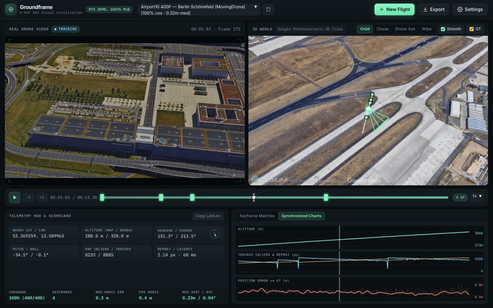
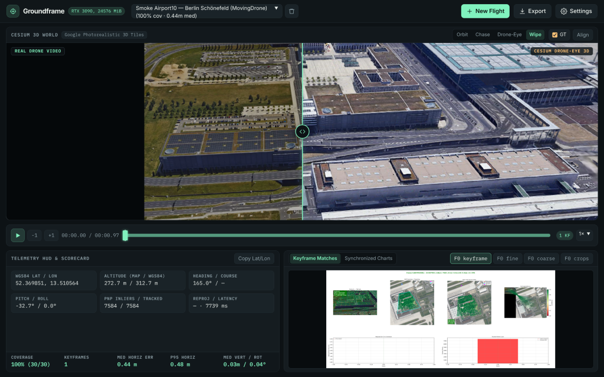
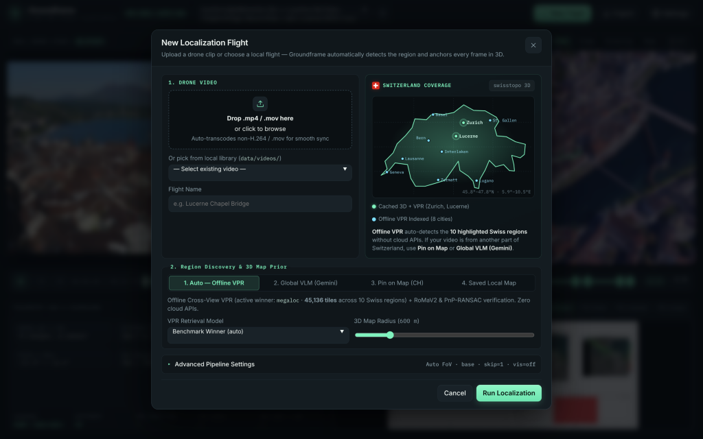

# Groundframe — 6-DoF UAV Visual Geo-Localization Studio

Video-only 6-DoF UAV localization anchored in public 3D geodata (no GPS or IMU required), paired with a synchronized **CesiumJS + Google Photorealistic 3D Tiles** Web Studio.

---

## Demo Overview

### Synchronized 3D Studio, Telemetry HUD & Ground-Truth Charts (`Orbit` + RTS Smoothing)


### Pixel-Level Alignment Verification (`Wipe Compare` vs Google Photorealistic 3D Tiles)


### Cold-Start Launcher (`+ New Flight` — Offline Mini-Switzerland VPR + 10-City Coverage Map)


---

## 6-DoF Localization Results (End-to-End Benchmarks)

Evaluated on an NVIDIA GeForce RTX 3090 (24 GB VRAM) using `OrthoTrack` + `RoMaV2`, single-file `0.2 m/px` DOP + DSM RAM preload (`scripts/prepare_map.py`), and RTS Kalman trajectory smoothing (`scripts/export_trajectory.py`).

| Flight / Benchmark | Frames | Coverage | Median Horiz Err | P95 Horiz | Median Vert | Median Rot | Effective FPS | Notes |
| :--- | :---: | :---: | :---: | :---: | :---: | :---: | :---: | :--- |
| **`MovingDrone / airport10`** (`airport10_400f`, RTS smoothed) | 400 | **100.0%** (`4 KF / 396 trk`) | **0.30 m** (0.32 m raw) | **0.40 m** (0.50 m raw) | **0.23 m** | **0.04°** | **14.44 FPS** (`61.9 ms` med) | Continuous aerial flight with metric 6-DoF GT |
| **`CrossLoc / EPFL Urbanscape`** (`Lausanne, CH`, real oblique 60°) | 100 | **99.0%** (`100 KF`) | **0.52 m** (raw) | **2.24 m** | **0.37 m** (`0.66 m` 3D) | **0.85°** | `1.99 FPS` (keyframe-only) | Real Swiss drone flight converted via `scripts/prepare_crossloc_urbanscape.py` against live `swisstopo` 3D tiles\* |
| **`Lucerne Kapellbrücke`** (`lucerne_kapellbruecke_22s`, real UAV) | 682 | **100.0%** (`37 KF / 645 trk`) | Visual alignment (`Wipe`) | — | — | — | **3.94 FPS** (`103.9 ms` med) | Wild YouTube drone footage (no GPS/IMU); cold-start localized via offline VPR |
| **`MovingDrone / airport10`** (`smoke_airport10`, 30f smoke) | 30 | **100.0%** (`1 KF / 29 trk`) | **0.35 m** | **0.45 m** | **0.10 m** | **0.04°** | `3.89 FPS` | Quick reproducible smoke test (`make smoke-test`) |

> \* **Note on RTS Kalman smoothing:** `scripts/export_trajectory.py` computes both raw (`est`) and RTS-smoothed (`est_smooth`) trajectories with a live **Smooth** toggle in the UI and GeoJSON/KML exporters. Smoothing improves continuous flights (e.g., `airport10_400f`: `0.32 m → 0.30 m`, `p95: 0.50 m → 0.40 m`), whereas discrete viewpoint sequences with large inter-frame jumps (like `epfl_urbanscape_oblique60_100f`, `tracked = 0`) should be inspected with **Smooth** unchecked (`0.52 m` raw error).

---

## Architecture: Two-Stage Offline Localization

```text
Raw Drone Video (.mp4 / .mov)
   │
   ▼  Stage 1a — Offline Cross-View VPR (MegaLoc, 45,136 Mini-Switzerland tiles, ~18 ms/frame)
   │             5-frame Reciprocal Rank Fusion (RRF) + 250 m spatial dedup → Top-5 candidates
   │
   ▼  Stage 1b — Geometric Verification (RoMaV2 coarse + PnP-RANSAC, ~5 s total)
   │             3D DSM PnP (cached maps) or Planar PnP + spatial spread guard (spread ≥ 0.32)
   │             ├── Verified ✓ ──► Lock winning (lat, lon) / local map
   │             └── Rejected ✗ ──► Safe 0% REJECTED + 1-click "Retry with Global VLM (Gemini)" / Pin on Map
   │
   ▼  Stage 2  — On-Demand 3D Map Fetch & Single-File Cache (scripts/fetch_swisstopo.py + prepare_map.py)
   │             Checks data/maps/ cache; if needed, downloads 1×1 km SWISSIMAGE + swissSURFACE3D tiles
   │             Builds cached single-file 0.2 m/px DOP (≤ 5980 px) + DSM for instant RAM preload
   │
   ▼  Stage 3  — Dense 6-DoF Tracking (OrthoTrack + RoMaV2 + Lucas-Kanade)
   │             Keyframe dense matching → 3D DSM lift → FoV auto-calibration → PnP → inter-frame optical flow
   │
   ▼  Stage 4  — RTS Smoothing, WGS84 Export & 3D Replay (FastAPI + CesiumJS)
                 RTS Kalman smoother → trajectory.json / CSV / GeoJSON / 3D KML + Orbit / Chase / Drone-Eye / Wipe
```

### Cold-Start Modes in `+ New Flight`

1. **Auto — Offline VPR (Default):** Zero cloud API calls. Searches the local **Mini-Switzerland** index (10 Swiss cities, 45,136 rotated multi-scale tiles) with **MegaLoc** and geometrically verifies Top-5 candidates via `RoMaV2 + PnP-RANSAC`.
2. **Global VLM (Gemini via OpenRouter):** Cloud fallback for Swiss regions outside the 10 pre-indexed cities (or when offline VPR rejects a run — available as a 1-click *"Retry with Global VLM"* button directly in the pipeline stepper).
3. **Pin on Map (CH):** Drop a manual pin anywhere in Switzerland on the Leaflet map to fetch live `swisstopo` 3D tiles on demand.
4. **Saved Local Map:** Run directly against any pre-cached metric GeoTIFF map in `data/maps/` (including non-Swiss datasets such as `MovingDrone/airport10`).

---

## Offline Cross-View VPR Benchmark: MegaLoc vs Sample4Geo

To replace cloud VLM reliance without guessing blindly, we built a shared **Mini-Switzerland** offline index and ran a controlled ablation comparing **MegaLoc** (`gmberton/MegaLoc`, DINOv2 + SALAD, 8448-D) against **Sample4Geo** (ConvNeXt-Base, official University-1652 Drone↔Satellite checkpoint `weights_e1_0.9515.pth`, 1024-D).

### Index Configuration (`scripts/build_vpr_index.py`)
- **Regions indexed (11 total, `airport10` strictly excluded):**
  - 3 high-res local Swiss maps: `zurich_limmat` (1,768 tiles), `lucerne` (1,956 tiles), `zurich_mav` (1,204 tiles).
  - 8 Swiss city expansion regions fetched via lightweight `2.0 m/px` `SWISSIMAGE`: `bern` (5,380), `basel` (5,380), `geneva` (4,548), `lausanne` (5,380), `interlaken` (5,380), `lugano` (5,380), `st_gallen` (5,380), `zermatt` (3,380).
- **Total tiles:** **45,136** (`300 m` tiles @ 150 m stride + `600 m` tiles @ 300 m stride, each rotated to `0° / 90° / 180° / 270°` for yaw invariance).
- **Hardware:** NVIDIA GeForce RTX 3090 (24 GB VRAM), fp16 embeddings in GPU memory.

### Overall Head-to-Head Results (Single-Frame Evaluation, 40 Queries)

Full raw numbers are stored in `outputs/vpr_benchmark/benchmark_results.json` (reproducible via `make benchmark-vpr`).

| Metric | **MegaLoc** (Winner) | Sample4Geo (U1652) |
| :--- | :---: | :---: |
| **Aerial Flights (`zurich_limmat` + `lucerne`, 16 frames) — Recall@1** | **50.0%** | 0.0% |
| **Aerial Flights — Recall@5** | **75.0%** | 25.0% |
| **Aerial Flights — PnP Geometrically Verified Acc** | **68.8%** | 18.8% |
| All Positive incl. low-altitude AGZ (24 frames) — Recall@1 / @5 / PnP | **33.3% / 54.2% / 45.8%** | 0.0% / 45.8% / 12.5% |
| **Out-of-Map Stress Tests (16 frames, 4 videos) — False Positives (FPR)** | **0 / 16 (0.0%)** | **0 / 16 (0.0%)** |
| Median PnP Inliers (Correct / Wrong / Negative) | **344.0 / 0.0 / 0.0** | 13.0 / 0.0 / 0.0 |
| Max Negative PnP Inliers (rejected by `spread_ratio < 0.32`) | 243 | 751 |
| Embedding Dim / Index Size (`fp16`, 45,136 tiles) | 8,448-D / 727.29 MB | **1,024-D / 88.16 MB** |
| Index Build Time (45,136 tiles on RTX 3090) | **181.17 s** | 234.70 s |
| Query Latency (Encode + GPU fp16 Search) | 16.51 + 1.67 = **18.18 ms** | 16.93 + 0.68 = **17.61 ms** |
| Peak VRAM (Build / Query) | 1,649 MB / 2,195 MB | 2,458 MB / **1,417 MB** |

### Per-Dataset Breakdown

| Dataset / Query Group | Frames | MegaLoc R@1 / R@5 / PnP | Sample4Geo R@1 / R@5 / PnP | Notes |
| :--- | :---: | :---: | :---: | :--- |
| **`zurich_limmat`** (`zurich_limmat_25s.mp4`) | 8 | **87.5% / 100.0% / 100.0%** (med 375 inl) | 0.0% / 0.0% / 0.0% | Oblique urban river/bridge flight |
| **`lucerne`** (`lucerne_kapellbruecke_22s.mp4`) | 8 | **12.5% / 50.0% / 37.5%** | 0.0% / 50.0% / 37.5% | Low-oblique lakeside landmark flight |
| **`zurich_mav`** (`AGZ_subset`, takeoff) | 8 | 0.0% / 12.5% / 0.0% | 0.0% / 87.5% / 0.0% | Ground/5 m AGL grass-field takeoff — horizontal tree-line view has minimal orthophoto overlap for PnP |
| **Stress: `forest_pine_21s.mp4`** | 4 | **0/4 FP** (max 243 inl) | **0/4 FP** (max 54 inl) | Out-of-map dense forest |
| **Stress: `water_sea_12s.mp4`** | 4 | **0/4 FP** (max 104 inl) | **0/4 FP** (max 751 inl) | Planar water hallucination caught by `spread_ratio` |
| **Stress: `fields_cultivated_15s.mp4`** | 4 | **0/4 FP** (max 0 inl) | **0/4 FP** (max 0 inl) | Repetitive farmland |
| **Stress: `suburb_residential_20s.mp4`** | 4 | **0/4 FP** (max 45 inl) | **0/4 FP** (max 166 inl) | Non-Swiss residential suburb |

### Production 5-Frame RRF + Geometric Verification (`app/vpr.py`)

In production, `localize_video_offline_vpr` samples **5 evenly spaced frames** (`8%..88%`), fuses per-frame Top-K rankings via **Reciprocal Rank Fusion (RRF)** so a single noisy frame cannot crowd out landmark frames, and verifies the fused Top-5 candidates with `RoMaV2 + PnP-RANSAC`:

| Video | Ground Truth | Offline VPR Decision | Winner & PnP Inliers | Spread Ratio | End-to-End Stage-1 Time |
| :--- | :---: | :---: | :---: | :---: | :---: |
| `zurich_limmat_25s.mp4` | Zurich | **ACCEPTED ✓** | `zurich_limmat` (**395 inl**) | `0.564` | `6.68 s` |
| `lucerne_kapellbruecke_22s.mp4` | Lucerne | **ACCEPTED ✓** | `lucerne` (**400 inl**) | `0.624` | `5.34 s` |
| `forest_pine_21s.mp4` | Out-of-map | **REJECTED ✗** | None (0% FP) | — | `5.06 s` |
| `water_sea_12s.mp4` | Out-of-map | **REJECTED ✗** | None (0% FP) | — | `4.85 s` |
| `fields_cultivated_15s.mp4` | Out-of-map | **REJECTED ✗** | None (0% FP) | — | `4.87 s` |
| `suburb_residential_20s.mp4` | Out-of-map | **REJECTED ✗** | None (0% FP) | — | `4.93 s` |

### Key Engineering Findings & Tradeoffs

1. **Why MegaLoc won:** `Sample4Geo` (University-1652) is trained on tightly centered single-building campus crops; on wide oblique European cityscapes (`Zurich` rivers/bridges) competing against 45k multi-city distractor tiles, its cross-view alignment collapsed (`0%` R@5 on Zurich). **MegaLoc** (DINOv2 + SALAD trained across diverse ground, aerial, and global VPR datasets) achieved **100% R@5 & 100% PnP accuracy on Zurich** and **68.8% single-frame / 100% 5-frame video accuracy** across both Swiss aerial flights.
2. **Why `spread_ratio >= 0.32` is essential for 0% FPR:** On planar `2.0 m/px` expansion tiles (no DSM, `Z = 0`), dense matchers like RoMaV2 can hallucinate hundreds of clustered matches on textureless surfaces (e.g., open sea matching Lake Geneva up to 751 planar inliers in Sample4Geo). Real urban correspondences always span `0.43–0.64` of the image frame, whereas hallucinations cluster tightly (`0.04–0.27`). Combining `conf >= 0.40`, `reproj <= 8 px`, `spread_ratio >= 0.32`, and mode-specific inlier floors (`120` for 3D DSM PnP, `250` for planar PnP) achieved **0/16 (0.0% FPR)** for both models.
3. **Honest limitations:**
   - **Low-altitude horizontal takeoff (`AGZ_subset`):** At ~5 m AGL looking horizontally across a grassy field toward trees, there is almost no geometric overlap with overhead orthophotos — neither model passes PnP verification until the drone climbs above the canopy.
   - **Memory footprint:** MegaLoc's 8,448-D descriptor is **8.25× larger** than Sample4Geo's 1,024-D (`727 MB` vs `88 MB` in fp16 for 45k tiles).
   - **Coverage boundary:** Offline VPR only retrieves regions present in `data/vpr_index/` (10 Swiss cities). Flights filmed elsewhere in Switzerland use **Pin on Map (CH)** or **Global VLM (Gemini)**.
4. **Offline VPR vs Cloud VLM (Gemini):**

| Dimension | Offline VPR (MegaLoc + PnP) | Cloud VLM (Gemini via OpenRouter) |
| :--- | :--- | :--- |
| Network / API Key | **100% offline, zero cost, private** | Requires internet + `OPENROUTER_API_KEY` |
| Spatial Coverage | Indexed regions (10 Swiss cities, extensible) | **Global zero-shot** (recognizes landmarks anywhere) |
| Latency | **~18 ms** retrieval + ~5 s PnP verification | ~2–5 s network round-trip |
| False-Positive Safety | **Mathematically verified (0% FPR)** via 3D PnP | Can hallucinate plausible coordinates on generic scenes |

### Scaling Math: Full Switzerland (~41,285 km²)

At our multi-scale configuration (`300 m` @ 150 m stride + `600 m` @ 300 m stride, 4 rotations):
- **Tile density:** ~222 tiles / km² → **~9.2M tiles** for all of Switzerland (or **~3.4M tiles** excluding uninhabited >2,000 m alpine glaciers/peaks).
- **Source orthophoto download:** At `2.0 m/px` `SWISSIMAGE` (`0.7 MB / km²` compressed GeoTIFF), all of Switzerland fits in **~29 GB** (vs ~2.5 TB at `10 cm/px`).
- **Index storage & search:** Raw fp16 MegaLoc (8448-D) for 9.2M tiles would take ~145 GB; applying **PCA-512 + FAISS `IVF16384_PQ64`** compresses the full-country index to **~590 MB** in RAM with `< 5 ms` ANN search latency, while keeping `RoMaV2 + PnP` verification unchanged on Top-5 candidates.

---

## 3D Map Data & On-Demand Tile Loading

The localization engine is **geographically agnostic** — it only requires two metric GeoTIFF layers covering the flight area:
- **DOP (Orthophoto):** overhead RGB imagery (`0.2 m/px` recommended; automatically prepared & cached into a single ≤5,980 px file by `scripts/prepare_map.py` for instant RAM preload in OrthoTrack).
- **DSM (Digital Surface Model):** per-pixel surface elevation including roofs and terrain.

### Why Switzerland (`swisstopo`)?
- Downloading all of Switzerland at `10 cm/px` would take **~2–3 TB**. Instead, this repo integrates the free public **swisstopo STAC API** (`https://data.geo.admin.ch/api/stac/v1/`), covering **100% of Switzerland** in `1×1 km` tiles (`EPSG:2056`):
  - `ch.swisstopo.swissimage-dop10` — 10 cm/px orthophoto (25 cm in high Alps; also available at 2.0 m/px for VPR indexing).
  - `ch.swisstopo.swisssurface3d-raster` — 50 cm/px LiDAR DSM.
- When a new Swiss location is requested, `scripts/fetch_swisstopo.py` downloads **only the 1–4 intersecting tiles** around `(lat, lon) ± radius` (~150–350 MB in ~15–30 s), caches them under `data/maps/`, and builds a single-file `0.2 m/px` DOP + merged DSM cache (`<map_dir>/cache/`) so OrthoTrack preloads the map directly into RAM (~35 s cold-start keyframe, ~2 s/keyframe thereafter).
- **Outside Switzerland (global extension):** place any metric-projected `DOP` and `DSM` GeoTIFFs in `data/maps/<site>/{dop,dsm}/` and select **Saved Local Map** — no tracker changes required.

> **Note on Google Photorealistic 3D Tiles:** Used strictly for 3D visualization and visual alignment verification (`Drone-Eye` / `Wipe Compare`) in CesiumJS, not as the localization map source.

---

## Quick Start

> Reviewing this project? Follow [REVIEWER_SETUP.md](REVIEWER_SETUP.md): it ships all data and weights as one zip and works on a Mac without a GPU.

**Requirements:** Linux with NVIDIA CUDA GPU (`≥ 16 GB VRAM` for `precise` matcher, `≥ 8 GB` for `base`/`turbo`), `uv`, `git`, `ffmpeg`.

```bash
# 1. Configure API keys (CESIUM_ION_TOKEN for Google 3D Tiles; OPENROUTER_API_KEY optional for VLM fallback)
cp .env.example .env

# 2. Clone pinned OrthoTrack/RoMaV2 + create Python 3.11 .venv via uv
make setup

# 3. Pre-cache RoMaV2 + VPR (MegaLoc & Sample4Geo) weights into .cache/
make download-weights

# 4. Build the offline Mini-Switzerland VPR index (45,136 tiles across 10 Swiss cities)
make build-index

# 5. Launch Web Studio at http://localhost:8000
make serve
```

### Useful CLI Targets

```bash
make check-gpu                                          # Verify PyTorch CUDA & RoMaV2
make smoke-test                                         # 30-frame benchmark on MovingDrone/airport10 (~0.35m median error)
make download-vpr-weights                               # Pre-download MegaLoc + Sample4Geo U1652 weights
make build-index                                        # Build Mini-Switzerland offline VPR index (MegaLoc + Sample4Geo)
make benchmark-vpr                                      # Re-run MegaLoc vs Sample4Geo + PnP ablation benchmark
make fetch-map LAT=47.3700 LON=8.5425 RADIUS=600 MAP_DIR=data/maps/zurich
make track VIDEO=data/videos/zurich/zurich_limmat_25s.mp4 MAP_DIR=data/maps/zurich_limmat OUT=outputs/zurich
```

---

## Project Layout

```text
app/                 FastAPI backend (offline VPR + PnP verifier, OpenRouter VLM fallback, SSE jobs, DJI .SRT parser, GeoJSON/KML export)
app/static/          Zero-build Web Studio UI (CesiumJS, 10-city Swiss coverage SVG, Leaflet pin map, Canvas charts, Smooth toggle, Wipe Compare)
scripts/             VPR indexer & benchmark, swisstopo fetcher, map cache builder, CrossLoc Urbanscape converter, RTS-smoothed WGS84 exporter
docs/                Architecture notes and Web Studio demo screenshots (docs/media/)
third_party/         Pinned OrthoTrack + RoMaV2 (gitignored, installed by `make setup`)
data/                Cached maps, 2 m/px Swiss VPR tiles, offline VPR index, demo videos, uploads (gitignored)
outputs/             Saved flight trajectories, VPR benchmark results, keyframe match visuals, metrics (gitignored)
```

## Known Constraints

- Works best on continuous flights with oblique-downward to nadir views (`~30°–90°` downward) over structured landmarks (buildings, roads, bridges, rivers).
- Featureless or out-of-map scenes (open sea, uniform dense forest, generic fields/suburbs) are intentionally rejected (`REJECTED · 0%`) rather than hallucinating poses.
- [OrthoTrack](https://github.com/cvg/orthotrack) is licensed under CC BY-NC 4.0 (research/demo use).
