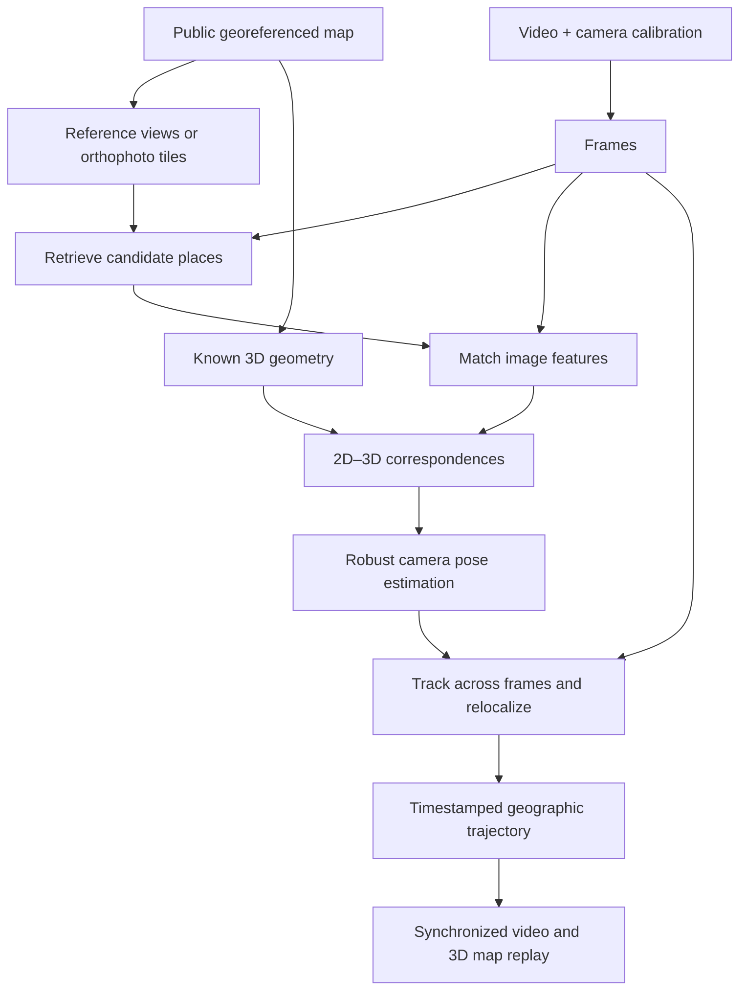

**I would build this as a system that matches drone video against a georeferenced map, verifies the matches geometrically, and uses consecutive frames to maintain a consistent trajectory.** Gaussian splats can then provide a compelling 3D replay and, potentially, improve pose refinement.

The most useful discoveries are **UAVD4L** for the public 3D reference map, **OrthoTrack** for continuous video localization, and **hloc + modern image matchers** for a flexible implementation. None should be treated as a complete, already-validated solution to every part of your brief.

Your answers establish the following scope:

- You choose the location and public dataset.
- The evaluation footage must come from a separate flight.
- Initial localization uses video alone; an approximate search area is an optional enhancement.
- The first version can process offline and replay the results.
- You have an RTX 3090.
- Accuracy should improve through measured iterations.
- Gaussian splats are preferred, while the public-data requirement is mandatory.

I interpret “video alone” as allowing a preloaded reference map and camera calibration, while withholding flight GPS, IMU orientation, and ground-truth poses. The search still has a boundary: the coverage of your reference database. Searching all of Earth would be a much larger project.

The research below reflects sources checked on **17 November 2026**. Recommendations are my engineering judgment; I have not reproduced the published experiments.

---

The field you are entering is usually called **visual localization**, **visual geo-localization**, or **map-based camera pose estimation**. Your particular problem combines absolute localization with trajectory estimation.

There are several related tasks worth distinguishing:

| Term | What it answers | Role in your project |
|---|---|---|
| **Visual place recognition / image retrieval** | Which mapped places look like this image? | Reduces a large search space to candidate locations. |
| **6-DoF visual localization** | Where is the camera, and how is it oriented? | Estimates three position coordinates and three rotation degrees of freedom. |
| **Visual odometry, VO** | How did the camera move between frames? | Provides local motion estimates. Errors accumulate over time. |
| **SLAM** | Where am I while building a map of my surroundings? | Useful for tracking and local reconstruction; still needs geographic anchoring. |
| **Visual-inertial odometry, VIO** | How did I move, using images and an IMU? | A possible later extension, outside your video-only baseline. |
| **Structure from Motion, SfM** | What camera poses and 3D structure explain this image collection? | Commonly used offline to construct reference maps. |
| **Relocalization** | Where am I after starting with no pose or losing tracking? | Essential for cold start and recovery. |
| **Bundle adjustment** | How can camera poses and 3D points jointly explain observations better? | Refines reconstruction or a trajectory using multiple frames. |

SLAM maintains a relationship between camera motion and scene structure. A typical system tracks image features, estimates motion, creates landmarks, optimizes its estimates, and recognizes previously visited places to correct accumulated error. The [Cadena et al. SLAM survey](https://arxiv.org/abs/1606.05830) is a good foundational introduction.

**Ordinary monocular SLAM does not automatically provide latitude, longitude, or height above sea level.** Its map usually starts in an arbitrary coordinate frame, and image geometry alone leaves absolute scale ambiguous. Learned depth priors can suggest scale, but they do not establish a geographic reference.

Your public map supplies that missing reference. Once a video feature is associated with a known 3D map point, the system can constrain the camera’s absolute position.

Also, localization is one component of navigation. Your requested demonstration establishes position and motion; route planning, obstacle avoidance, and flight control would be separate projects.

Gaussian splatting belongs to a different part of this picture. A 3D Gaussian scene represents appearance using many spatial Gaussian primitives with color, opacity, size, and orientation. It enables fast rendering from new viewpoints. The [original 3DGS project](https://repo-sam.inria.fr/fungraph/3d-gaussian-splatting/) explains the representation.

For your task, splats offer three useful capabilities:

1. Render reference images from candidate camera poses.
2. Compare a rendered view with the real frame to refine an existing pose.
3. Display an attractive reconstruction with the estimated flight path.

However, **a visually convincing splat is not evidence of accurate geometry or geographic coordinates**. A `.ply` file may have arbitrary scale and origin, and rendered depth may contain errors. GauU-Scene’s research explicitly investigates disagreement between visual quality metrics and geometric reconstruction quality. [GauU-Scene V2](https://arxiv.org/abs/2404.04880)

I would preserve a trustworthy mesh, point cloud, or elevation model for geometric estimation even if splats become the main visual representation.

---

**Dataset selection is the first engineering milestone.** You need more than a beautiful 3D scene: you need map provenance, independent query imagery, calibration, coordinate systems, and an evaluation reference.

These are the candidates I would investigate in this order:

| Dataset | Why it matters | Important limitation for your task |
|---|---|---|
| **[UAVD4L](https://github.com/RingoWRW/UAVD4L)** | Closest match to a public, geographically aligned, textured 3D map with independently acquired UAV queries. | Query acquisition includes still images at two-second intervals and manually captured images. It does not automatically give you a conventional continuous video benchmark. |
| **[CrossLoc: Urbanscape / Naturescape](https://github.com/TOPO-EPFL/CrossLoc-Benchmark-Datasets)** | Public geodata, rendered reference observations, and real drone photographs. Strong alternative for geographic localization. | Primarily an image localization benchmark. Its standard random image splits do not establish your desired independent-flight evaluation by themselves. |
| **[UAVScenes](https://github.com/sijieaaa/UAVScenes)** | Sequential imagery, calibration, 6-DoF poses, and reconstructed meshes/point clouds. Attractive for the video demonstration. | Published maps are reconstructed from groups of sequences. You must establish that the chosen query flight contributed nothing to the reference map. |
| **[AerialVL / GeoVINS releases](https://github.com/hmf21/AerialVL)** | Long real flight sequences, geographic reference imagery, raw-data releases, and a published DEM release. | The original evaluation data emphasize horizontal position. Full altitude/orientation ground truth and raw image preprocessing require inspection. |
| **[OrthoLoC](https://deepscenario.github.io/OrthoLoC/)** | Excellent benchmark for matching drone images to orthophotos and surface models, including domain changes. | Samples use anonymized local coordinates. They cannot automatically support real latitude/longitude output. |
| **[MovingDrone / OrthoTrack](https://orthotrack.ethz.ch/)** | Convenient continuous sequences, map data, poses, and a closely matched implementation. | Its rendered sequences are useful for development, but cannot replace your independent real-flight demonstration. |

A few findings materially affect the choice.

**UAVD4L is my first choice for proving the absolute localization component.** Its paper describes a roughly 2.5 km² reference area, geographic alignment using RTK and ground control, and separate reference/query acquisition. Its pose labels are nevertheless *pseudo ground truth*, produced through reconstruction, registration, and refinement; they are not an independent precision measurement of every camera pose. The supplied pipeline also uses orientation/gravity information in some configurations, which your baseline must disable. [UAVD4L paper](https://arxiv.org/html/2401.05971v1)

There is now a useful [UAVD4L Hugging Face release](https://huggingface.co/datasets/RingoWRW97/UAVD4L-Model/tree/main), listing an approximately 48.5 GB OSGB model archive and a 7.46 GB query archive. That is a concrete public 3D asset, although I have not downloaded or validated its contents.

**CrossLoc deserves serious consideration if geographic provenance becomes the priority.** Its reference generation uses public Swiss geodata, while the queries are real drone photographs. The associated [TOPO-DataGen project](https://github.com/EPFL-ENAC/TOPO-DataGen) provides the rendering workflow and example geographic assets. Its supplementary material also documents ground-truth limitations, including degraded positioning in Naturescape. [CrossLoc supplementary material](https://openaccess.thecvf.com/content/CVPR2022/supplemental/Yan_CrossLoc_Scalable_Aerial_CVPR_2022_supplemental.pdf)

**UAVScenes is promising for the final replay, conditional on a clean split.** The paper says it reconstructs eight maps from groups of one to three sequences. Selecting a different filename or held-out frame is therefore insufficient: the reference reconstruction must exclude the evaluation flight. [UAVScenes paper](https://arxiv.org/html/2507.22412v1)

**AerialVL has two easily missed issues.** Its distributed imagery includes heading normalization and geographic coordinates in filenames. The original altitude ground-truth question was also acknowledged by the maintainer. Use raw imagery for the strict baseline and keep metadata available only to the evaluator. The newer releases may improve coverage, but their contents still need inspection. [Dataset documentation](https://github.com/hmf21/AerialVL), [maintainer’s altitude clarification](https://github.com/hmf21/AerialVL/issues/8)

**OrthoLoC is valuable for component evaluation, but its geographic anonymization matters.** The paper applies a per-sample translation to geometric data. Unless the inverse transform is available, a locally accurate pose cannot be converted into its original geographic position. Its paired image/map crops also isolate matching from retrieval, so success there does not demonstrate a large-area cold start. [OrthoLoC paper](https://arxiv.org/html/2509.18350v1)

For Gaussian-focused datasets, **GauU-Scene, UrbanScene3D, and the datasets supported by CityGaussian** are useful reconstruction resources. I did not verify a ready-made splat package among them that also satisfies your independent real-flight, geographic-coordinate, and trajectory-ground-truth requirements. [CityGaussian data preparation](https://github.com/Linketic/CityGaussian/blob/main/doc/data_preparation.md)

The practical decision is therefore: **start with UAVD4L for pose estimation, while resolving the continuous-flight dataset before investing heavily in the interface.** A sequence of photographs can demonstrate repeated localization, but turning it into an MP4 does not validate video tracking.

---

The processing architecture I recommend is:

The important distinction inside this architecture is between **finding plausible places** and **proving a camera pose**. An image embedding can identify a similar-looking neighborhood. Geometry must then establish whether enough visible landmarks support a consistent camera position.

There are two practical ways to obtain those landmarks.

With a **textured 3D map**, render reference images and depth from known viewpoints. Match the query frame to those images, then use reference depth to recover the matched landmarks’ 3D positions.

With an **orthophoto plus a digital surface model**, match the frame to the orthophoto. Each matched map pixel has horizontal coordinates, and the surface model supplies its elevation. This produces the same kind of 2D–3D correspondence.

An orthophoto is a geographically corrected overhead image. A digital surface model, or DSM, gives the height of the visible surface, including roofs and vegetation. A terrain model describes bare ground. Confusing those surfaces can introduce systematic errors around buildings and trees.

The resulting pose problem is **Perspective-n-Point, PnP**:

> Given known 3D landmarks, their observed image locations, and camera calibration, find the camera position and orientation.

RANSAC makes this robust to incorrect matches by testing hypotheses and identifying a geometrically consistent subset. OpenCV and PoseLib already implement these solvers. [OpenCV PnP documentation](https://docs.opencv.org/4.x/d5/d1f/calib3d_solvePnP.html)

Your main subproblems, and the obstacles attached to each, are:

| Subproblem | What must work | Main obstacle |
|---|---|---|
| **Reference-map preparation** | Load geometry, textures, scale, coordinates, and coverage. | Missing transforms, inconsistent datums, incomplete geometry. |
| **Camera preparation** | Preserve timestamps; handle distortion, resolution changes, and calibration. | Zoom, digital stabilization, cropping, rolling shutter, motion blur. |
| **Cold-start retrieval** | Find relevant map regions without knowing the initial pose. | Unknown heading, altitude, field of view, and repeated-looking places. |
| **Cross-view matching** | Match real video features to the map representation. | Different viewpoints, shadows, seasons, reconstruction artifacts. |
| **Metric pose estimation** | Recover a physically plausible camera pose from correspondences. | Outliers, weak geometric configuration, inaccurate depth. |
| **Temporal tracking** | Maintain a coherent path between successful absolute localizations. | Low parallax at altitude, lost features, abrupt camera motion. |
| **Recovery** | Detect a bad estimate and search again. | Confidently locking onto a similar-looking wrong location. |
| **Geographic output** | Convert map poses to latitude, longitude, and meaningful height. | Axis conventions, projection errors, missing vertical datum. |
| **Evaluation** | Measure accuracy and failure rate on independent data. | Leakage, uncertain ground truth, reporting only successful frames. |
| **Replay** | Synchronize video, pose, map, and diagnostic evidence. | Smooth animation can conceal estimator failures. |

Several of these deserve particular attention.

**Camera calibration can dominate altitude accuracy.** On nearly flat terrain, focal length and camera height can compensate for one another: a different focal length at a different height produces a similar image. Estimating both from weak geometry is difficult. Start with known dataset calibration and a fixed image-processing pipeline. OrthoLoC explicitly analyzes this coupling. [Calibration analysis](https://arxiv.org/html/2509.18350v1)

**High-altitude imagery can be difficult for monocular motion estimation.** Distant terrain produces little parallax between nearby frames. A system may track image motion well while estimating depth and translation poorly. This is one reason to repeatedly anchor estimates to the reference map.

**Camera orientation, drone orientation, and travel direction are separate outputs.** A gimbal can rotate independently of the airframe. Video can estimate the camera’s pose; the trajectory can estimate course over ground when the drone is moving. Recovering body heading requires the camera-to-body relationship, including gimbal motion. The interface should label these quantities accurately.

**Height above sea level requires a vertical reference.** Three common quantities are:

- Height above the reference ellipsoid.
- Orthometric height, approximately height above mean sea level.
- Height above the ground beneath the drone.

For ellipsoidal height \(h\) and geoid undulation \(N\), orthometric height is approximately:

\[
H = h - N
\]

Use the appropriate datum transformation and geoid model. GeographicLib and PROJ provide the necessary machinery. If the dataset’s vertical reference is unknown, report that explicitly instead of labeling arbitrary map height “MSL.” [GeographicLib](https://geographiclib.sourceforge.io/C++/doc/geoid.html), [PROJ vertical transformations](https://proj.org/en/stable/operations/transformations/vgridshift.html)

**Coordinate conventions are a frequent source of plausible-looking bugs.** For a world-to-camera transform \(X_c=RX_w+t\), the camera center is \(C=-R^\top t\); `t` itself is not the camera’s world position. Keep a documented convention for axes, quaternion ordering, units, and transforms. COLMAP documents its conventions clearly. [COLMAP format documentation](https://colmap.github.io/format.html)

---

For implementation, these are the components I would actually prioritize:

| Component | Reuse candidate | My recommendation |
|---|---|---|
| Complete video localization approach | **[OrthoTrack](https://github.com/cvg/orthotrack)** | First implementation to examine for continuous tracking with public orthophotos and DSMs. |
| Modular localization framework | **[hloc](https://github.com/cvg/Hierarchical-Localization)** | Best starting framework for a reference-image / 3D-map pipeline. Mesh rendering and depth integration still need adaptation. |
| Sparse feature matching | **[SuperPoint + LightGlue](https://github.com/cvg/LightGlue)** | A practical baseline for matching video to reference renders. |
| Dense feature matching | **[RoMa v2](https://github.com/Parskatt/RoMaV2)** | Strong candidate for difficult cross-view matches; compare against the sparse baseline. |
| Candidate-place retrieval | **[MegaLoc](https://github.com/gmberton/MegaLoc)** | Test pretrained descriptors on rendered reference views. Its general retrieval performance does not guarantee aerial performance. |
| Robust pose estimation | **[PoseLib](https://github.com/PoseLib/PoseLib)** or OpenCV | Reuse an established PnP/RANSAC implementation. |
| Local motion baseline | **[DROID-SLAM](https://github.com/princeton-vl/DROID-SLAM)** | Useful comparison or later tracking component, with explicit geographic anchoring. |
| Gaussian rendering | **[gsplat](https://docs.gsplat.studio/main/)** | Practical CUDA renderer with depth rendering and Python bindings. |
| Gaussian pose refinement | **[GS-CPR](https://github.com/XRIM-Lab/GS-CPR)** | Add after obtaining a reliable coarse pose. |
| Geographic visualization | **[CesiumJS](https://github.com/CesiumGS/cesium)** | Good fit for geographic trajectories, terrain, and camera frustums. |
| Local splat visualization | **[Spark](https://github.com/sparkjsdev/spark)** | Useful Three.js renderer for a detailed splat view. |

**OrthoTrack is unusually close to your desired behavior.** It localizes keyframes against orthophotos, lifts matches into 3D using a DSM, tracks those map correspondences between frames, and relocalizes when needed. Its paper explicitly describes initialization without GPS or IMU, searching the available orthophoto coverage. That makes it more relevant than a generic SLAM demo. [OrthoTrack paper](https://arxiv.org/html/2606.25245v1)

Its documentation lists at least 16 GB VRAM for the default precise matcher, so your 3090 is a plausible development machine. This is not a guarantee that every map, resolution, and configuration fits. Published throughput is measured on different hardware and must be remeasured locally. [OrthoTrack requirements](https://github.com/cvg/orthotrack)

**hloc is the more flexible option when the full 3D map is central.** It already organizes retrieval, matching, reconstruction, and pose estimation. For your application, use its components around rendered views and known geometry rather than rebuilding the entire localization framework.

**GS-CPR is a refinement method.** It starts with a coarse pose, renders the Gaussian scene, matches that render to the query using MASt3R, and estimates a refined pose. It does not solve an unrestricted cold start by itself. [GS-CPR method](https://xrim-lab.github.io/GS-CPR/)

Two further Gaussian papers are worth knowing:

- **[UGS-Loc](https://github.com/kmk97/UGSLoc)** incorporates uncertainty in pose priors and Gaussian geometry. It is a later experiment if refinement reliability becomes important.
- **[GSVisLoc](https://gsvisloc.github.io/)** directly studies localization against Gaussian scene representations, but its project page still lists code as “coming soon.” I would not make the first implementation depend on it.

For learning and comparison, **[ORB-SLAM3](https://github.com/UZ-SLAMLab/ORB_SLAM3)** and **[MASt3R-SLAM](https://github.com/rmurai0610/MASt3R-SLAM)** are relevant SLAM systems. **[VGGT](https://github.com/facebookresearch/vggt)** is relevant for inferred multi-view geometry. None independently supplies your required Earth coordinate reference.

There is also a practical reuse constraint: public availability does not imply unrestricted startup use. OrthoTrack lists a noncommercial license; OrthoLoC and UAVScenes also have noncommercial terms. Record the license of the code, weights, and data separately before committing to a deliverable. [OrthoTrack](https://github.com/cvg/orthotrack), [OrthoLoC](https://deepscenario.github.io/OrthoLoC/), [UAVScenes](https://github.com/sijieaaa/UAVScenes)

---

I would organize development into these iterations, each producing something reviewable.

1. **Establish one valid map/query pair.**  
   Load a public map, calibration, query imagery, and evaluation poses. Verify geographic transforms, vertical datum, coverage, and independent acquisition. Produce a small evidence sheet showing what is known and what remains uncertain.

2. **Localize individual frames from a cold start.**  
   Retrieve candidates, match features, solve PnP, and render the estimated viewpoint. Begin with tens of representative queries. Measure failures as well as errors. This establishes whether the core idea works.

3. **Process a genuine flight sequence.**  
   Add correspondence tracking and periodic absolute relocalization. Output timestamped poses plus status such as `searching`, `localized`, `tracking`, or `lost`. Keep frame-level diagnostics.

4. **Build the synchronized replay.**  
   Show video, estimated trajectory, ground truth, camera frustum, altitude, and error over time. The viewer reads saved results, so UI work does not repeatedly trigger GPU processing.

5. **Improve the largest measured failure source.**  
   Compare matchers, reference-view density, multi-frame initialization, and temporal refinement. Change one factor at a time. Since offline processing is allowed, evaluate whole-sequence refinement too, while labeling it as offline.

6. **Add Gaussian splats and test their contribution.**  
   Use a public splat if a suitable one exists, or derive a splat representation from the public reference asset. Never use the evaluation flight to build it. Compare pose accuracy before and after refinement.

7. **Demonstrate robustness.**  
   Start from different points in the flight, expand the search area, introduce short visual outages, and evaluate an additional independent flight.

A useful early distinction is between **causal estimates**, which use only frames available so far, and **offline refined estimates**, which can use later frames. Both are legitimate for your first version, but their results should be reported separately.

For evaluation, I would record:

| Measurement | What it reveals |
|---|---|
| Horizontal error: median and 95th percentile | Typical performance and the worse part of the distribution. |
| Vertical error separately | Whether altitude is actually working. |
| Rotation error | Whether the estimated camera orientation is accurate. |
| Recall at several position/rotation thresholds | How often localization succeeds to a useful tolerance. |
| Cold-start success rate and time to first fix | Whether initial localization works reliably. |
| Lost duration and recovery time | How the system handles failure. |
| Worst error and false-localization count | Whether it confidently returns dangerous-looking nonsense. |
| Processing time and peak VRAM | Whether the approach is practical on your 3090. |

**Evaluate geographic accuracy without fitting the predicted trajectory to ground truth afterward.** A post-hoc rotation, translation, or scale fit can make a drifting or geographically incorrect trajectory look good. Such alignment can be useful for a separate VO diagnostic, but it does not prove absolute localization.

Also keep the test flight out of reference-map construction, splat training, parameter tuning, and candidate selection. Ground-truth coordinates hidden in filenames, EXIF, subtitles, or dataset loaders are a particularly easy source of leakage.

---

For the “wow effect,” I would prioritize features that make the result both visually compelling and technically convincing:

| Priority | Demonstration feature | Why it impresses |
|---|---|---|
| **1** | **Real video beside a render from the estimated pose**, with a wipe slider | The audience can see buildings and terrain align. |
| **2** | **A cold start from an arbitrary frame** | Shows that the system actually finds its location. |
| **3** | **Synchronized 3D trajectory and camera frustum** | Makes position, height, and viewing direction immediately understandable. |
| **4** | **Ground-truth comparison and error timeline** | Supports the claims with measurements. |
| **5** | **Visible loss and recovery** after a short blackout or corrupted segment | Demonstrates failure handling. |
| **6** | **Matched landmarks shown in both the video and map** | Explains the geometric evidence behind the estimate. |
| **7** | **Gaussian-splat fly-through along the estimated path** | Provides the polished visual centerpiece. |
| **8** | **Baseline comparison**: independent frame localization versus temporal tracking | Shows the improvement your work contributes. |
| **9** | **Optional location-prior toggle** | Quantifies how much an approximate area improves initialization. |
| **10** | **A second flight with different appearance** | Demonstrates that the result survives beyond a selected showcase clip. |

My preferred presentation would be a short replay with four synchronized elements: the real frame, the estimated-view rendering, the map trajectory, and an error/status panel. Include one difficult segment and the subsequent recovery.

For confidence, start with understandable evidence: inlier count, reprojection error, spatial distribution of matches, and temporal consistency. Do not label an arbitrary score “95% confidence.” A probability or uncertainty region needs calibration against held-out errors.

AI coding agents can accelerate dataset adapters, coordinate checks, experiment runners, visualizations, and documentation. Give them concrete contracts—for example, a pose file with timestamps, coordinate frame, units, status, and provenance—and small verified fixtures. The pieces most deserving careful human review are the dataset split, coordinate transforms, geometric assumptions, and evaluation protocol.

For your initial reading, I would follow this sequence: the [SLAM survey](https://arxiv.org/abs/1606.05830) for concepts, [UAVD4L](https://arxiv.org/html/2401.05971v1) for the map-to-image problem, [hloc](https://github.com/cvg/Hierarchical-Localization) for implementation structure, [OrthoTrack](https://arxiv.org/html/2606.25245v1) for continuous trajectories, and [GS-CPR](https://xrim-lab.github.io/GS-CPR/) for the Gaussian extension.

**The first concrete deliverable should be a small set of independently acquired drone frames localized against a public map, with measured errors and rendered-view overlays.** That will resolve the core feasibility question and provide the foundation for the video demonstration.

I did not download the large dataset archives, run these repositories, or benchmark your GPU. The main remaining risk is securing a verified independent video/map pair with usable geographic and altitude ground truth.

---------------

**Start with one known site, 30 frames, and OrthoTrack.** It already does the hard middle part: finding matching landmarks, estimating the camera position, and following it through the video. Your first milestone is a dot on the map, a picture showing which landmarks put it there, and a measured error. [OrthoTrack](https://github.com/cvg/orthotrack)

[Full Markdown guide with inputs, outputs, tools, and one quick improvement per milestone](/home/andrii/Projects/career/localization-uav/docs/05-milestones-inputs-and-outputs.md)

| Milestone | Input | Output | Start with |
|---|---|---|---|
| 1. Prepare the map | Overhead photo + surface heights for the same site | A map where each visible roof or road point has a 3D position | One bundled [MovingDrone scene](https://github.com/cvg/orthotrack/blob/main/dataset/movingdrone.md) |
| 2. Read the video | MP4 + camera calibration | Images with timestamps and lens parameters | Bundled reader, or [PyAV](https://pyav.org/docs/stable/api/time.html) |
| 3. Find matching landmarks | One video image + map image | Pixel pairs showing the same roof corner or road marking | [RoMaV2](https://github.com/Parskatt/RoMaV2), included in OrthoTrack |
| 4. Locate the camera | Matched pixels + their 3D map positions | Camera position and orientation | [OpenCV PnP](https://docs.opencv.org/4.x/d5/d1f/calib3d_solvePnP.html) |
| 5. Follow the flight | Known landmarks + next video frame | Updated pose, or `lost` followed by a fresh map search | [OrthoTrack’s optical flow and recovery](https://orthotrack.ethz.ch/) |
| 6. Put it on Earth | Camera pose + map coordinate system and height reference | Latitude, longitude, height above mean sea level, and direction of travel | [pyproj](https://pyproj4.github.io/pyproj/stable/api/transformer.html) and [GeographicLib](https://geographiclib.sourceforge.io/html/GeoidEval.1.html) |
| 7. Prove it works | Estimated path + withheld reference positions | Error in meters, percentage of frames located, and a replay | Feed estimates into the [existing Groundframe player](/home/andrii/Projects/career/localization-uav/groundframe-demo/groundframe.html) |

**The first upgrade I’d show:** pause the video and draw the mapped building outlines over the actual roofs. A reviewer can see immediately whether the position *and* viewing angle make sense. OrthoTrack ships the overlay script. If you later have an aligned Gaussian splat of that same site, add a wipe between the real frame and the rendered view. [Overlay script](https://github.com/cvg/orthotrack/blob/main/scripts/visualize_results.py) · [gsplat](https://docs.gsplat.studio/main/apis/rasterization.html)

**The first model I’d change depends on what breaks.** If searching many map tiles is slow, try [MegaLoc](https://github.com/gmberton/MegaLoc). If you need learned matching on CPU, try [XFeat](https://github.com/verlab/accelerated_features). If the matches look correct but altitude is consistently wrong, check the height reference before changing models.

Two constraints affect the choice. MovingDrone’s demo footage is rendered, so reserve a separate real flight for the final demonstration. OrthoTrack’s code is noncommercial. For a commercially reusable handoff, start with the independent OpenCV baseline in the guide. I checked the repositories and runner outputs. Local speed and accuracy remain unmeasured, and this session couldn’t confirm a working CUDA driver. [MovingDrone](https://orthotrack.ethz.ch/) · [OrthoTrack license](https://github.com/cvg/orthotrack/blob/main/LICENSE)
